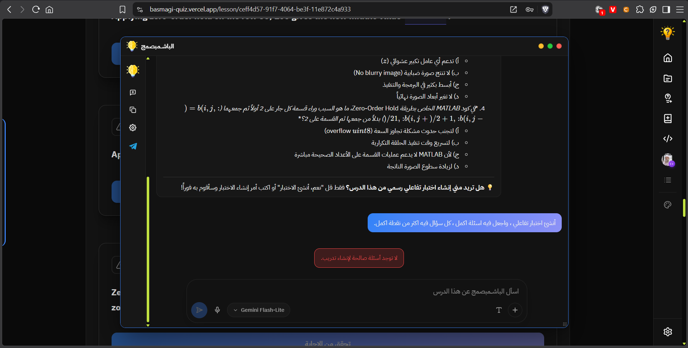

# Project Issues and Follow-up Work

## What is this file
`docs/issues.md` is were I draft my notes/ideas on updated that I'm currently doing, or things I found while testing the pages. These are mostly either fixes or new features ideas. These are drafts that changes constantly, not actual plans that are ready to be implemented. 

Issues in here have to be studies and tested well, then turned into a plan, before actually implementing it.

## Patches 

### AI Agent
Newly created notebook, the chat didn't include the presented card at the bottom as I expected. .

Prompt Cleaning: 
* The system prompts for AI need to be updated for the new tools.
* I tested this prompt: `أنشئ مجلدًا جديدًا لمادة 'الذكاء الاصطناعي'، واصنع بداخله درسًا تأسيسيًا وامتحانًا تدريبيًا عليه.`
  * It created a course using the `create-course` tool.
  * Then it tried to create a lesson using `create-lesson` with this JSON Block but failed, because lessons require a title:
  ```
  {
    "sections": [
      {
        "title": "مفهوم الذكاء الاصطناعي وأقسامه",
        "blocks": [
          {
            "body": "الذكاء الاصطناعي (Artificial Intelligence) هو فرع من علوم الكمبيوتر يهدف إلى إنشاء أنظمة قادرة على أداء مهام تتطلب عادةً ذكاءً بشرياً مثل التعلم، الاستدلال، واتخاذ القرار.",
            "type": "markdown"
          },
          {
            "type": "markdown",
            "body": "ينقسم الذكاء الاصطناعي بشكل أساسي إلى عدة مجالات رئيسية تشمل:\n1. **تعلم الآلة (Machine Learning):** تمكين الأنظمة من التعلم وتحسين الأداء من خلال البيانات دون برمجة صريحة.\n2. **التعلم العميق (Deep Learning):** فرع من تعلم الآلة يستخدم الشبكات العصبية الاصطناعية لنمذجة أنماط معقدة.\n3. **معالجة اللغات الطبيعية (NLP):** تمكين الآلات من فهم وتوليد اللغة البشرية.\n4. **رؤية الكمبيوتر (Computer Vision):** تمكين الحواسيب من فهم وتفسير الصور والفيديوهات."
          }
        ]
      },
      {
        "title": "تعلم الآلة (Machine Learning)",
        "blocks": [
          {
            "type": "markdown",
            "body": "يُعرف تعلم الآلة بأنه قدرة النظم الحاسوبية على التعلم الذاتي من البيانات. وتنقسم خوارزمياته إلى نوعين رئيسيين:\n- **التعلم المُشرف (Supervised Learning):** يتم تدريب النموذج باستخدام بيانات موسومة (مدخلات ومخرجات معلومة).\n- **التعلم غير المُشرف (Unsupervised Learning):** يتم البحث عن أنماط خفية في بيانات غير موسومة."
          },
          {
            "options": [
              "التعلم المُشرف (Supervised Learning)",
              "التعلم غير المُشرف (Unsupervised Learning)",
              "التعلم التعزيزي (Reinforcement Learning)",
              "التعلم العميق فقط"
            ],
            "prompt": "أي من أنواع تعلم الآلة يعتمد على بيانات تدريب موسومة (تحتوي على الإجابات الصحيحة)؟",
            "type": "question",
            "explanation": "التعلم المُشرف (Supervised Learning) يستخدم بيانات معرّفة أو موسومة تحتوي على المدخلات والمخرجات الصحيحة لتدريب النموذج.",
            "correctIndex": 0,
            "questionKind": "mcq"
          }
        ]
      }
    ],
    "folder": "الذكاء الاصطناعي",
    "description": "مدخل تأسيسي لمفاهيم الذكاء الاصطناعي وتعلم الآلة"
  }
  ``` 
  * Then it tried to create a quiz using `create-quiz`, it didn't provide "title", "description", or "folder", yet the quiz was created.
  * The system prompts related to these toold need to be updated. 

### MATLAB loading animation isn't working in high performance mode, and the lesson page's loading shimmer needs to be improved.

### Sign in
.
* This is extremely annoying, it's telling me my session has ended, but its still showing me that I'm signed in in the sidebar's dropdown and in the profile page, and I don't know why are sessions ending quickly.
* Sometimes it tells me that, then when the page reloads automatically and I find that I'm still signed in, I try again, and it works this time.

## New Features

### YouTube Videos
New Type of items (like Quizzes, Lessons, and Notebooks): YouTube Videos. Users should be able to add YouTube videos in their content (I.e., `/my-content`). Admins should be able to upload them. Connect the `YOUTUBE_DATA_API_KEY`, which I got from `console.cloud.google.com` after enabling 'YouTube Data API v3':
* Allow users to import videos, and more features, too.
* Admins should be able to upload videos.
* Add a custom modal in `/my-content`, in the `#userContentContextMenu` menu, but totally different and custom.
* MCP Tools should be updated to support it.
* AI-Agent Tools

The necessary YouTube API is already set in `.env.local` and will be set in Vercel later.

Related Files:
* `public\src\features\home\`: The directory of the home page.
* `public\index.html`: The HTML File of the home page.

DON'T WRITE CODE, but generate a ready-to-execute implementation plan in `docs\plans\` after asking me for any decision/questions that you need to know, that plan is going to be implemented by another developer, so it shouldn't include questions.

### Implement the Rich Input Component into the Notebook page's Makrdown cells.

### Update the `createEmptyState`
* Update the `createEmptyState` to include a link to the `/how-to-create-content`

### Code Blocks
* Add Line numbers, VS-Code-style.

### Result Pages

#### Videos (Easy to make and intersting idea)
* Add a result-page feature that displays themed meme videos based on the user’s degree or score.
* Suggested themes include:
  * دعوية
  * إسلامية
  * قرآن
  * ميمز تشجيع سلبية
  * ميمز تشجيع إيجابية
* Some vidoes will be displayed based on the percentage of the result.

### `public\about.html` Page

#### Redesign
Redesign the whole page:
* Journey style page with different scroll effects for each different sections.
* Natural Scrolling smoothness, don't make it too smooth like how typical AI-made scroll effects look. See standards, or search.
* It should use its own CSS styling instead of importing from the main page or other pages.
* It sill should be resposive to the themes of the platform, even if new themes get added.
* It shouldn't use the shared animations, it should get its own animations (or no animations).
* It lacks images or visual elements. Tell me what you need to add.

#### Suggestions
* Add a short testimonial or review.
* **Make all the docs measurable.** We already have an analytics beacon, so add one event for "copied MCP URL" and one for "opened My Content from a draft link". That tells us whether people finish setup. A "Was this helpful?" thumbs row per section would also show which steps confuse people.

#### Important Update
* See [update plan.](plans/documentation-pages.md)

### Connect Canva
Think of a new way to download quizzes and lessons, maybe through canva.

### Download Lessons as Video (MCP Server Export)
[plan](plans/lesson-video-export-plan.md).
* Claude sometimes gets confused and doesn't know how to install Manim to render the code, so tell it context on how to do it. Or maybe Manim isn't even the best way to make videos, maybe chromium is.
* Test the VO That can be downloaded in the Claude Sandbox.

*The plan has been delayed until we implement this plan first: [Proper Voice-Over](plans/advanced-read-aloud.md). Because it's going to be reused for the videos' VO, too.*

### Translation and content expansion (Suggestion)
* Native English translation support with native LTR pages.

## Suggestions

### Notebook Page (I.E., `public/notebook.html`)

#### Image Tool (`imtool`): remaining recommendations

Done so far: fit-to-image window size, MATLAB-style title, touch pixel info, "..." More menu, click-to-pin, snap to neighbouring windows, readable minimized tabs.

#### 1. Tile / Arrange windows (high value)
- Buttons for Tile side-by-side, Tile stacked and Cascade, shown when two or more image windows are open.
- Today students drag and resize windows by hand for every before/after comparison.

#### 2. Link views (high value)
- A toggle that syncs zoom and pan across image windows.
- Shared pixel marker: hovering or pinning a pixel in one window highlights the same pixel in the others, and every status bar updates together.

#### 3. Compare tool
- Pick two windows and view them as a slider wipe, a blend or an absolute difference.
- Useful for filtering and histogram-equalization demos.

#### 4. Pixel neighbourhood
- Show a small 5x5 grid of values around the pinned pixel (helps with convolution / filter lessons).
- Show the value as a MATLAB expression, e.g. `I(9,9) = 184`, so students connect the window to the code.

#### 5. Analysis panels
- Histogram panel and an intensity profile along a drawn line.
- Contrast adjustment (like MATLAB's Adjust Contrast) and a colormap selector for grayscale images.

#### Notes
- MATLAB behaviour check: two `imshow` calls in a row show only the last image (same figure and axes are reused), so the current output is correct. `imtool` opens a separate window each time.
