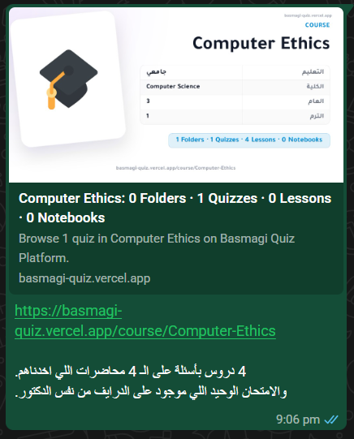

# Project Issues and Follow-up Work

## What is this file
`docs/issues.md` is were I draft my notes/ideas on updated that I'm currently doing, or things I found while testing the pages. These are mostly either fixes or new features ideas. These are drafts that changes constantly, not actual plans that are ready to be implemented. 

Issues in here have to be studies and tested well, then turned into a plan, before actually implementing it.

## Patches

### Globa Issue with buttons
* Hovering buttons on their border make cause them to flash in a buggy way, that issue is probably related to their transition changing their location or something similar.

### Update OG Titles & Descriptions (`api/og.js`)
Folders and Courses' OG titles & OG desciptions should updated to include lessons and notebooks. 

### Quiz Passwords are exposed
The home page downloads every quiz’s password to the browser, so passwords are readable by anyone. Which is a security flaw that needs to be fixed.

### AI Agent

#### Dictation
Fix Dictation: The dictation doesn't work on Brave browser, even though other websites I built worked fine on Brave Browser when using the browser api for dictation.

### Performance (Globally, but specially the main page)
Performance Improvements: Currently, there are many custom mechanism fucntionalities built in JS that works perfectly, but it may exist natively in HTML, CSS, or as a browser API. In that case we shouldn't reinvent the wheel, specially if it exists natively. Anything that exists natively in HTML, CSS, or as a browser API should be used that way and we should delete any custom JS implementation that has native alternatives. That would improve performance very well. Search for everything, anything that can be implemented in HTML & CSS directly without JS should be done so. You can search the web for modern HTML & CSS, because sometimes they add new things, but watch out for compatibility with different browsers (minimum requirenment: Chrome). But I don't want to miss up any functionality, this is just for performance, not to change any fucntionality.

Example 1: I lately found out that the `/quiz` page was rendering questions through the JS once, then when the user submits their answer, the JS renders the question again to inject the explanation & formal answer, I removed it and depended fully on CSS & HTML, the whole question including explanation & formal answer is now injected all at the first render, then I make things visible when the user submits the answer using CSS classes. That approach to get away from JS improved performance alot. (This is already patched and tested).

Example 2: The markdown engine was manually detecting the direction of sentences to determine their `direction`. A previous performance update deleted all of the related code and forced it to use the native attribute `dir="auto"`. (This is already patched and tested). 

Example 3 (The Sidebar/Side-menu's): The sidebar component is a part that is common to all pages. Its JS and CSS are the same and are imported in all pages, but the HTML is duplicated, which means it's extremely hard to maintain and update. And it became to messy. And it's not even the same, the docuement pages don't have the HTML directly in them, it's inserted from a JS file. 

## New Features

### Tooltips
* Standing on a quiz card, lesson card, or notebook card, and hovering the title or description should show a tooltip with their full content (since long title/descriptions get truncated).

### Content Card Design
* The current design of notebook cards, lesson cards, and quiz cards on the whome page is a mess.
* Notebooks and lessons basically cannot be told apart from each other.
* The naming of things is messed up, because of how much things were reused when implementing new features, for example, the dropdown menu used on all 3 of them is called (exam-dropdown-menu), even though exams on the platform are typically called `quizzes`, and this UI element isn't used on quizzes only anyways. The code quality needs to be improved.
* When lessons & notebooks are mixed with quizzes in a course, it looks like a mess with some cards taller than others. , we need to redeisgn the hight, width, and how much of the title & description can be shown to control the card styles better.
* The user content section is named (امتحانك), aside from the platform now supporting lessons and notebooks, too, so not only quizzes, but even that name was confusing when it was only quizzes, because users thought it was the history not content they create, name it something expressive like (إنشاء) or (إنشاء محتوى) or your recommendation.

### Online MatLab Compiler
I recently built an online jupytor-notebook-style matlab compiler website specializing in the fundametals of MatLab: [exact copy of its code](../online-matlab-compiler)
* And before improving it further, I figured it would be better and more dynamic if I integrate it inside Basmagi-Quiz (this website) instead of being a seperate website.
  * So it would be a new different one or two types next to quizzes and lessons: (notebooks with matlab-compiler engine). And admins can make new notebooks for matlab. 
  * That would make it great and expandable feature (I can add C++ or Python compiler for the fundamentals in the future).

Objective: 
* Implement the online matlab compiler in this website.
* Recomment types: 
  * Since I want this to be expandable should this be just a third type (notebook) next to quizzes and lessons? 
  * Or should it be different types (matlab, c++, python, etc...)?
  * Should I add the new notebook type only? Or should I also add code-editor or something similar?

Some parts of the platform will need to be like:
* The markdown engine to add proper coloring for the matlab code.
* The امتحاناتك section: to support the new types of content we will add. With proper creation modals + ready-to-use prompts.
* Admins should be able to upload whatever new types we will add.
* The MCP Server should be updated to support them, too.

### Dictation for Essay Questions (Lesson & Quiz Pages)
Add dictation feature for essays in quizzes and lessons

### Result Pages

#### Videos (Easy to make and intersting idea)
* Add a result-page feature that displays themed meme videos based on the user’s degree or score.
* Suggested themes include:
  * دعوية
  * إسلامية
  * قرآن
  * ميمز تشجيع سلبية
  * ميمز تشجيع إيجابية
* Some vidoes will be displayed based on the percentage of the result.

### `public\about.html` Page
* Suggestion: Add an open-source Angle (Since the repo is currently open source).
* Suggestion: Add a short testimonial or review.
* Suggestion: Add the number of views of the whole platform (try to integrate vercel insights if possible) to the `المنصة بالأرقام` section.
* Extend the `كيف بُنيت المنصة؟` section to include `SEO (Search Engine Optimization)`, `GEO (Generative Engine Optimization)`, and MCP Server.

### Create Quiz Page
`create-quiz.js` is 5000+ lines in one file — It's the right time to split it into modules.

### Connect Canva
Think of a new way to download quizzes and lessons, maybe through canva.

### Download Lessons as Python Manim (MCP Server Export)
[plan](plans/lesson-video-export-plan.md).
* Claude sometimes gets confused and doesn't know how to install Manim to render the code, so tell it context on how to do it.
* Test the VO That can be downloaded in the Claude Sandbox.

### Translation and content expansion (Suggestion)
* Native English translation support with native LTR pages.

### Offline Page
Improve:
* It's theme Should match the theme of the platform (see themes.css and theme-controller.js), but it shouldn't import these files, it should be independent. It should also default to the default theme of the platform.

### `api\og.js`
* Special courses that get the (مادة مميزة) badge, since there is no info table displayed, the middle of the image becomes emtpy, I need to fill it with something, or ideas to improve it when it has the  (مادة مميزة) badge. 

### Notebooks

#### Improve the Image Tool modal
* 
* It shouldn't be a modal that has a set location/width/height, it should be a draggable and resizable window, just like the actual MATLAB Program

#### What’s not done:

* Shortcuts: Jupyter command-mode shortcuts (A, B, D D, M, Y) are not built—Shift+Enter, Ctrl+Enter, and the toolbar work.
* Exports: they contain no cell outputs, because outputs aren’t stored. Exporting from within a notebook should give the user the option to include the outputs.
* Not tested: the admin publish flow and a live Supabase.
* The runtime bundle in public/assets/notebook-runtime/ was rebuilt from the changed source, so commit it along with the rest. The notes are in docs/NOTEBOOKS.md.