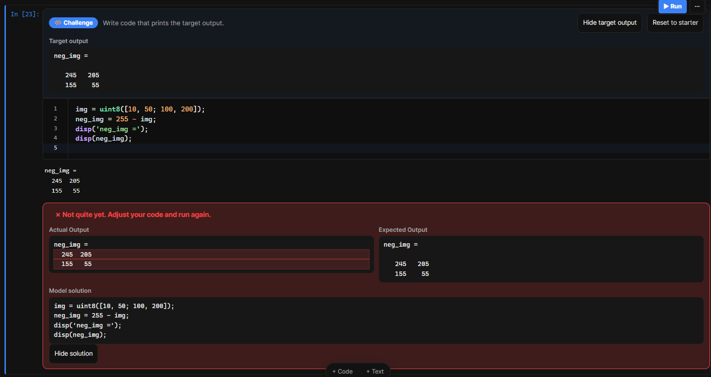

# Project Issues and Follow-up Work

## What is this file
`docs/issues.md` is were I draft my notes/ideas on updated that I'm currently doing, or things I found while testing the pages. These are mostly either fixes or new features ideas. These are drafts that changes constantly, not actual plans that are ready to be implemented. 

Issues in here have to be studies and tested well, then turned into a plan, before actually implementing it.

## Patches 

## Concentrate on gamefied experience and reward scheduele

## MATLAB Notebook
* Continue this plan: [plan](<plans/MLWeb Image Processing Course Coverage and Performance UX — Implementation Plan.md>). Some parts of it are already implemented.

## Offline Support.
* Users who have Installed the application: The notebook Page (e.g., `/notebook/new` and notebooks they saved locally at `/my-content`) should work offline as well as.
* The quiz page and the lesson page should also work, people who have lessons and quizzes locally (i.e., `/my-content`) should work offline.

### Sign in
.
* This is extremely annoying, it's telling me my session has ended, but its still showing me that I'm signed in in the sidebar's dropdown and in the profile page, and I don't know why are sessions ending quickly.
* Sometimes it tells me that ("انتهت صلاحية الجلسة. يرجى تسجيل الدخول مجددًا."), then when the page reloads automatically and I find that I'm still signed in, I try again, and it works this time.
* There appears to be some timeout, when it run out, people automatically get signed out, which is extremely annoying, remove it, people should never be signed out automatically.

## New Features

### Admin Dashboard & Develpers Dashaboard
* Developers currently have their dashboard: `/control`, but it needs a link that only appears for developers inside the `#sideMenuProfileDropdown` and the side-menu on phones.
* Admins & Developers can also see `/reports` to solve reports.
* But there is no dashboard for admins:
  * To see the content they uploaded
  * To see how many views they got on their content.
  * To see how many reports they got.
  * Also have a version of the platform's stats on their.
  * And other things, too.
* Their is no notification center for the platform.

### Implement the Rich Input Component into the Notebook page's Makrdown cells.

### Code Blocks
* Add Line numbers, VS-Code-style.

### Result Pages

#### Videos (Easy to make and are an intersting idea)
* Add a result-page feature that displays themed meme videos based on the user’s degree or score.
* Suggested themes include:
  * دعوية
  * إسلامية
  * قرآن
  * ميمز تشجيع سلبية
  * ميمز تشجيع إيجابية
* Some vidoes will be displayed based on the percentage of the result.

### `public\about.html` Page

#### Redesign
Redesign the whole page:
* Journey style page with different scroll effects for each different sections.
* Natural Scrolling smoothness, don't make it too smooth like how typical AI-made scroll effects look. See standards, or search.
* It should use its own CSS styling instead of importing from the main page or other pages.
* It sill should be resposive to the themes of the platform, even if new themes get added.
* It shouldn't use the shared animations, it should get its own animations (or no animations).
* It lacks images or visual elements. Tell me what you need to add.

#### Suggestions
* Add a short testimonial or review.
* **Make all the docs measurable.** We already have an analytics beacon, so add one event for "copied MCP URL" and one for "opened My Content from a draft link". That tells us whether people finish setup. A "Was this helpful?" thumbs row per section would also show which steps confuse people.

#### Measure what works. 

We already have cookieless analytics. Tagging the entry points (sidebar, sign-in, upload wizard, toast, empty state) with a ?from= value would show which one actually brings people to the guides. Then you can drop the ones nobody uses instead of guessing.

### Connect Canva
Think of a new way to download quizzes and lessons, maybe through canva.

### Download Lessons as Video (MCP Server Export)
[plan](plans/lesson-video-export-plan.md).
* Claude sometimes gets confused and doesn't know how to install Manim to render the code, so tell it context on how to do it. Or maybe Manim isn't even the best way to make videos, maybe chromium is.
* Test the VO That can be downloaded in the Claude Sandbox.

*The plan has been delayed until we implement this plan first: [Proper Voice-Over](plans/advanced-read-aloud.md). Because it's going to be reused for the videos' VO, too.*

### Translation and content expansion (Suggestion)
* Native English translation support with native LTR pages.

## Suggestions

### Public profile for all users
* Public profile for all users, so all users get a public `/@userName` instead of a localOnly `/profile`.
* That profile would be public for everyone.
* The local `المتصدرين` leaderboard (i.e., `#localLeaderboardCard`) will be replaced with a real leaderboard: Shows the top 10 students.
* Sync is really bad between admins' profile and their localStorage.

### YouTube Update: Recommendations (not requested; propose, do not build without a go-ahead)

2. **Admin «نقل» for several items** and the bulk bar for published items. Today move and delete are per item. The bulk bar exists only for «محتواي».
3. **Rename and edit description for a published item** (admin): `rename-item` and `update-item-metadata` could accept the `youtube` type like `move-item` now does. Titles from YouTube are sometimes bad for a course page.
4. **Refresh metadata.** Titles, descriptions and thumbnails change on YouTube, and videos become private or deleted. An admin action (and maybe a scheduled job) to re-fetch and flag unavailable items, plus a graceful "unavailable video" state in the player window instead of a blank iframe.
5. **Watch progress.** Remember the playback position and mark watched videos per device (a thin localStorage layer), show a progress bar on the card thumbnail, and a "continue" state for playlists. The history helper `local-youtube-history.js` is a base.
6. **Playlist window quality of life:** next/previous and autoplay, a "currently playing" highlight in the list, search inside long lists (up to 200 items), and remembering the last played item.
7. **Player window:** playback speed and picture-in-picture are already in the YouTube iframe UI, but keyboard shortcuts for the window itself (Esc to minimize, F to maximize) and a visible focus trap/return-focus on close would help accessibility.
8. **Accessibility pass** on cards and windows: roles, `aria-label`s in Arabic, focus order, and contrast of the badge on bright thumbnails.
9. **Upload wizard polish:** show a thumbnail and a type icon for each YouTube row in the review tree, warn about a duplicate before upload (the server already answers 23505), and show per-item results for YouTube in the final step. And make all loading animations excluded from the High Performance Mode, see `themes.css` to see how to do that.
10. **Quota and performance:** cache `channels.list` and `videos.list` results, batch ids, and lazy-load card images. Consider moving published playlist `items` out of the catalog fetch (already lazy) and paginating long lists.
11. **Tests worth adding:** copy-tree with YouTube (§1.5), the embed/link builders (§2), the window snap math, the attachment kind mapping (§1.3), and the admin `move-item` with the `youtube` type (extend `admin-action-routing`).
12. **Code health:** the two copies of `youtube-mcp-model.js` (`public/src/shared/` and `scripts/lib/`) can drift. Add a test that fails when they differ, or generate one from the other in the build.
