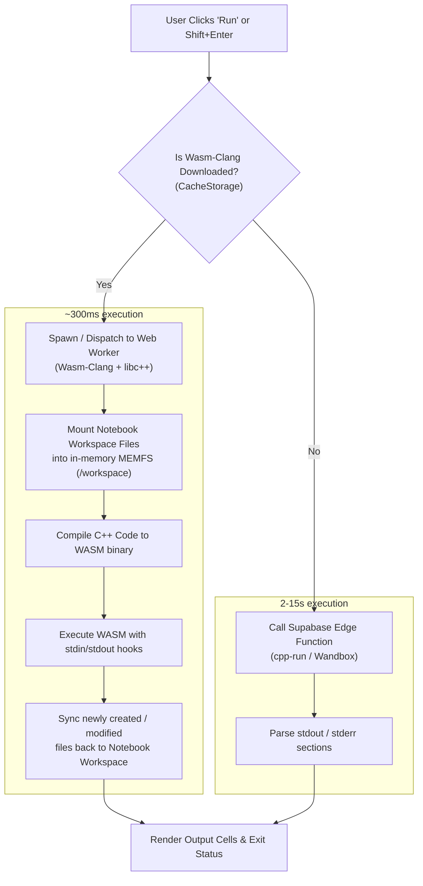

# Implementation Plan: Client-Side C++ WebAssembly Runtime (Wasm-Clang)

## Executive Summary
This plan details the migration of the C++ notebook from a slow, cloud-dependent compilation path (which relies on external Wandbox/Piston servers and causes 10–20+ second delays or timeouts) to a **hybrid dual-engine architecture**:
1. **Fast Local Mode (WebAssembly Clang):** Compiles and runs locally in the browser in **~200–500 ms** inside a Web Worker. Supports C++ Fundamentals, Object-Oriented Programming (OOP), and reading/writing text files via `<fstream>` using a virtual filesystem synchronized with the notebook's "Current Folder".
2. **Cloud Fallback Mode:** The existing `cpp-run` Edge Function remains fully functional for users who choose to avoid downloading the ~20MB local compiler.

To handle the ~20MB payload respectfully, users are **never forced** to download it. A persistent toolbar button (**"⚡ 20MB Fast Compiler"**) opens a dedicated dialog with a live download progress bar, a clear label guaranteeing it is a one-time download, and an option to delete it to reclaim disk space.

---

## 1. Scope & Capabilities

The local WebAssembly compiler specifically targets university and introductory C++ curricula:
* **Programming Fundamentals:**
  * Control structures (`if`, `switch`, `while`, `for`)
  * Functions, pass-by-reference/pointer, recursion
  * Arrays (1D/2D), C-strings, `std::string`
  * Dynamic memory (`new`, `delete`), pointer arithmetic
  * Interactive stdin (`std::cin`) using the notebook's inline input prompt
* **Object-Oriented Programming (OOP):**
  * Classes, structs, encapsulation (`public`, `private`, `protected`)
  * Constructors, destructors, copy constructors, member initializer lists
  * Inheritance (single, multiple, hierarchical)
  * Polymorphism, virtual functions, abstract classes, pure virtual functions
  * Operator overloading (`operator+`, `operator<<`, etc.)
* **File Input/Output (`<fstream>`):**
  * `std::ifstream`, `std::ofstream`, `std::fstream`
  * Reading and writing text files (`.txt`, `.csv`, `.dat`) directly from/to the notebook workspace ("Current Folder").

---

## 2. Architecture & Execution Flow



---

## 3. User Experience & UI Specifications

### 3.1 Toolbar Trigger Button
A dedicated button is added to the C++ notebook toolbar next to the "Workspace" toggle:
* **State A: Not Downloaded (Default)**
  * Label: `⚡ 20MB Fast Compiler` (Arabic: `⚡ المترجم السريع (20م.ب)`)
  * Styling: Subtle highlight pill with an alert dot indicating high-performance option available.
  * Clicking opens the **Download Management Dialog**.
* **State B: Downloading**
  * Label: `⬇ 45%` with a spinner.
* **State C: Downloaded & Active**
  * Label: `⚡ Local Compiler (Fast)` (Arabic: `⚡ مترجم محلي (سريع)`)
  * Clicking opens the dialog with status info and a button to remove/free space.

### 3.2 Download Management Dialog
A modal dialog (`<dialog id="cppWasmDialog">`) built using the existing shell dialog system (`runtimes/shared/dialogs.ts`):

1. **Header & Context:**
   * Title: **"Instant C++ Local Compiler"** / **"المترجم المحلي السريع للـ C++"**
   * Badge: `20 MB · One-time download` / `تحميل لمرة واحدة فقط`
2. **Prominent Notice:**
   > **Note:** This is a **one-time download** (~20 MB). Once downloaded, C++ compiles instantly inside your browser without contacting external servers and works **100% offline**. It will not be re-downloaded on future visits.
3. **Controls (Before Download):**
   * Primary Button: `[ Download Fast Compiler (~20MB) ]` / `[ تحميل المترجم السريع (20 م.ب) ]`
   * Secondary Button: `[ Keep Cloud Compiler (0 MB) ]` / `[ البقاء على المترجم السحابي ]`
4. **Download in Progress (Live Progress Bar):**
   * Progress track: Smooth animated CSS progress bar showing `XX%`.
   * Details label: `11.4 MB / 20.2 MB (56%)` with download speed.
   * Button: `[ Cancel ]` (aborts the fetch controller and clears temporary partial cache).
5. **Downloaded State (Management):**
   * Status: `✓ Ready · Stored in local browser cache`
   * Action: `[ Delete & Reclaim 20 MB ]` (clears the CacheStorage entry and restores Cloud Mode).

---

## 4. Technical Design

### 4.1 Storage & Cache Management (`runtimes/cpp/src/wasm-cache.ts`)
* Uses the native **`CacheStorage` API** (`caches.open('basmagi-cpp-wasm-v1')`).
* Why `CacheStorage` over IndexedDB:
  * Designed natively for `Response` streaming and blob persistence.
  * High storage quota.
  * Easy checking via `cache.match(url)`.
* **Download with progress:**
  Uses a `fetch()` with a `ReadableStream` reader tracking `Content-Length` and `loaded` bytes, updating the progress callback on every chunk, then writing the completed `Response` to `CacheStorage`.

```typescript
export interface DownloadProgress {
  loaded: number;
  total: number;
  percent: number;
}

export async function isWasmCached(): Promise<boolean>;
export async function downloadWasmAssets(onProgress: (p: DownloadProgress) => void, signal: AbortSignal): Promise<void>;
export async function deleteWasmCache(): Promise<void>;
export async function getWasmBinary(): Promise<ArrayBuffer>;
```

### 4.2 Web Worker Architecture (`runtimes/cpp/src/worker/`)
Compilation and execution must never block the main browser UI thread:
* **`cpp-worker.ts`:**
  1. Instantiates the Clang WebAssembly module with Emscripten environment.
  2. Sets up virtual file tree (`MEMFS`):
     * `/workspace`: Seeded with text files passed from the notebook's workspace.
  3. Replays earlier cells + target cell using the existing cell assembly format (`assemble.js`).
  4. Runs Clang compiler to produce an executable WebAssembly artifact in memory.
  5. Executes the generated binary:
     * Intercepts `write` calls to capture `stdout` and `stderr`.
     * Intercepts `read` calls on `stdin` (can use synchronized `Atomics.wait` / `SharedArrayBuffer` or step-wise input promises).
     * Collects modified/created files in `/workspace`.
  6. Posts result back to `engine.ts` with execution time (`~200–400ms`).

### 4.3 Workspace Files & `<fstream>` Integration
* Update [`public/src/shared/runtime-config.js`](file:///d:/Code%20projects/Websites/منصة%20إمتحانات%20بصمجي/public/src/shared/runtime-config.js):
  * Change `cpp.workspaceExts` from `[]` to:
    ```javascript
    workspaceExts: [".txt", ".csv", ".dat", ".json", ".in", ".out"]
    ```
* In [`runtimes/cpp/src/engine.ts`](file:///d:/Code%20projects/Websites/منصة%20إمتحانات%20بصمجي/runtimes/cpp/src/engine.ts):
  * Set `caps.files = true` so the "Current Folder" strip appears.
  * Pass current workspace files to the compiler worker before running code.
  * When execution finishes, any new files created by `std::ofstream` are saved back to the notebook session.

---

## 5. Step-by-Step Implementation Roadmap

### Phase 1: Storage & Downloader Module
- [ ] Create `runtimes/cpp/src/wasm-cache.ts`:
  - `checkWasmInstalled()`
  - `downloadWasmBundle(onProgress, abortSignal)`
  - `clearWasmCache()`
- [ ] Add unit tests in `runtimes/test/wasm-cache.test.mjs` verifying cache read/write, progress calculation, and abort behavior.

### Phase 2: UI & Dialog Implementation
- [ ] Add strings to `CPP_AR` and `runtimes/shared/i18n.ts` for download prompt, progress, one-time guarantee, and cache management.
- [ ] Create `runtimes/cpp/src/wasm-dialog.ts` managing the `<dialog>` and progress bar element.
- [ ] Add the `⚡ 20MB Fast Compiler` button to the C++ toolbar in `runtimes/cpp/src/engine.ts` / `index.ts`.
- [ ] Style the progress bar and dialog in `runtimes/cpp/src/wasm-dialog.css` using the platform's CSS variable design tokens.

### Phase 3: WebAssembly Toolchain Assets & Worker
- [ ] Place pre-compiled, optimized Wasm-Clang binaries and minimal C++ standard header bundle in `public/assets/notebook-runtime-cpp/wasm/`:
  - `clang.wasm` (~14 MB brotli-compressed)
  - `sysroot.tar` (~4 MB compressed: `<iostream>`, `<fstream>`, `<string>`, `<vector>`, etc.)
  - `wasm-runner.js` (Worker runtime)
- [ ] Build the worker script `runtimes/cpp/src/worker/cpp-worker.ts`:
  - Compiler invocation with `-std=c++17 -O0` for fast compilation.
  - In-memory MEMFS mapping to `/workspace`.
  - Capture compiler diagnostics with line/col numbers matching cell lines.

### Phase 4: Engine Integration & Dual-Mode Dispatch
- [ ] In `runtimes/cpp/src/engine.ts`:
  - On run request: check if WASM cache is ready.
  - If **ready**: dispatch run to `cpp-worker.ts`.
  - If **not ready**: dispatch run to existing cloud `execute` (`cpp-run` Edge Function).
  - Format output status badge: display `Exit 0 · 240ms · local` vs `Exit 0 · 8400ms · wandbox`.

### Phase 5: Workspace File I/O (`<fstream>`)
- [ ] Update `RUNTIME_CONFIG.cpp.workspaceExts` in `public/src/shared/runtime-config.js` to accept `.txt, .csv, .dat`.
- [ ] Enable `caps.files: true` in `runtimes/cpp/src/engine.ts`.
- [ ] Hook `engine.attach()` to read workspace files and sync post-run filesystem diffs.
- [ ] If user tries file operations in Cloud Mode, display a friendly notice:
  *"File I/O requires the Fast Local Compiler. Click '⚡ 20MB Fast Compiler' in the toolbar to enable it."*

### Phase 6: Build, Verification & Documentation
- [ ] Run `npm run build:runtimes` and verify bundle integrity in `build-info.json`.
- [ ] Run `npm run typecheck:runtimes` and `npm run test:runtimes`.
- [ ] Test sample programs:
  1. **Fundamentals:** Loops, arrays, pointer manipulation, `std::cin` input prompt.
  2. **OOP:** Base class, derived class, virtual function dispatch, operator overloading.
  3. **File I/O:** Write a string to `records.txt` with `ofstream`, read it back with `ifstream`, and verify it appears in the Current Folder strip.
- [ ] Update `docs/runtimes.md` and resolve the task in `docs/issues.md`.

---

## 6. Edge Cases & Mitigations

| Edge Case | Risk | Mitigation |
| :--- | :--- | :--- |
| **Download Interrupted / Network Lost** | Partial 20MB file corrupts cache | Stream chunks to memory; only commit to `CacheStorage` when hash/size validates 100%. If aborted, discard incomplete chunks. |
| **User on Low-End Mobile / Slow Connection** | Might accidentally trigger 20MB download | The button does not download immediately; it opens the dialog explaining the 20MB size and requires a confirming click on "Download Now". |
| **Infinite Loop in Student Code** (`while(true)`) | Freezes local worker thread | The engine enforces a 10-second client-side execution timeout with `worker.terminate()` if exceeded. |
| **Storage Quota Exceeded** | Browser rejects CacheStorage | Catch storage errors and fall back gracefully to Cloud Mode with a helpful toast message. |
| **Cloud Mode with File I/O** | Student runs file code without WASM | Gracefully detect `<fstream>` usage and suggest clicking the Fast Compiler button. |

