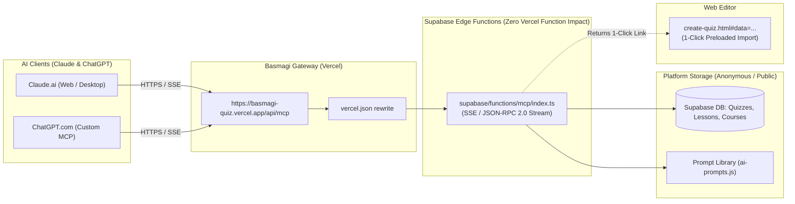

# Basmagi Quiz MCP Connector: Implementation Plan

This plan establishes a **Model Context Protocol (MCP)** server for **منصة إمتحانات بصمجي (Basmagi Quiz)**, allowing users of **Claude.ai** and **ChatGPT.com** to connect to the platform as a custom connector.

---

## 1. Architectural Blueprint & Constraints



### Key Constraints & Design Choices
1. **Zero Student Tracking / No Login Policy:**
   - No user sign-in, cookies, or account tokens. 
   - Claude and ChatGPT connect with **"No Auth"**.
   - All catalog data returned is strictly public/anonymized.
2. **Vercel Hobby 12-Function Cap Preservation:**
   - The repository currently hosts **exactly 12 serverless functions** under `api/`. Adding a 13th file will trigger Vercel deployment failure.
   - Vercel Hobby also enforces a 10-second timeout, which drops long-lived SSE connections needed by MCP.
   - **Solution:** Follow the existing project pattern established in `supabase/functions/lesson-progress/index.ts`. Implement the MCP server as a **Supabase Edge Function** (`supabase/functions/mcp/index.ts`), proxied cleanly via `vercel.json` (`/api/mcp`).
3. **1-Click Quiz/Lesson Delivery:**
   - When Claude or ChatGPT generates a quiz, it returns the structured Basmagi JSON alongside a direct import URL: `https://basmagi-quiz.vercel.app/create-quiz#data=<compressed-json>`.
   - Clicking the link opens `create-quiz.html` with the questions pre-loaded into the editor and saved to the student's browser `localStorage`.

---

## 2. Tools & Capabilities Offered to Claude & ChatGPT

| Tool / Primitive | Type | Description |
| :--- | :--- | :--- |
| `search_catalog` | Tool | Search public courses, folders, quizzes, and lessons by keyword with optional scope filter (`quizzes`, `lessons`, `courses`, `all`). |
| `get_quiz` | Tool | Retrieve full quiz metadata, question texts, options, correct answers, and explanations by quiz ID. |
| `get_lesson` | Tool | Retrieve complete lesson content (markdown sections, explanations, and embedded questions) by lesson ID. |
| `get_prompts` | Tool / MCP Prompt | Retrieve prompt templates from `ai-prompts.js` (`General_Purpose_AI_Prompt`, `English_Specializing_Prompt`, `Math_Specializing_Prompt`) and `ai-agent-default-prompts.js`. |
| `create_quiz_import_link` | Tool | Validates a generated quiz against Basmagi schema and returns both standard JSON and a 1-click pre-filled import URL. |
| `get_creator_info` | Tool | Public info & links about the creator (Belal Amr Mohamed) matching `_tools.js`. |

---

## 3. Step-by-Step Implementation Tasks

### Phase 1: Client-Side 1-Click Import Handler
*File to modify:* [`public/src/features/create-quiz/create-quiz.js`](file:///d:/Code%20projects/Websites/منصة%20إمتحانات%20بصمجي/public/src/features/create-quiz/create-quiz.js)

1. In `DOMContentLoaded`, check for URL hash:
   - Detect `#data=<base64-or-encoded-json>` or `#import=<json>`.
2. Parse the payload safely:
   - Validate against the existing `buildUserQuizEntry()` shape.
   - If valid, skip `showEntryScreen()`, invoke `showQuizForm()`, inject the parsed questions into `quizData`, update question navigator, and trigger `pushHistorySnapshot()`.
3. Clear the hash without reloading the page (`history.replaceState`) so refreshing doesn't duplicate the import.

---

### Phase 2: Supabase Edge Function MCP Server
*New directory & file:* `supabase/functions/mcp/index.ts`

1. **Protocol Implementation:**
   - Implement MCP JSON-RPC 2.0 specification over HTTP and Server-Sent Events (SSE).
   - Support `initialize`, `notifications/initialized`, `ping`.
   - Support `tools/list` and `tools/call`.
   - Support `prompts/list` and `prompts/get`.
2. **CORS & Headers:**
   - Allow headers: `Content-Type`, `Authorization`, `x-requested-with`.
   - Allow origin `*` (required for Claude.ai and ChatGPT.com web clients).
3. **Handlers:**
   - **`search_catalog`**: Query Supabase `courses`, `folders`, `quizzes`, and `lesson_public` tables.
   - **`get_quiz`**: Query `quizzes` table by ID and return parsed questions.
   - **`get_lesson`**: Query `lesson_public` table by ID and return markdown content.
   - **`get_prompts`**: Return prompts from `ai-prompts.js`.
   - **`create_quiz_import_link`**: Generate safe base64/URI encoded payload pointing to `https://basmagi-quiz.vercel.app/create-quiz#data=...`.

---

### Phase 3: Vercel Gateway & Rewrite Routing
*File to modify:* [`vercel.json`](file:///d:/Code%20projects/Websites/منصة%20إمتحانات%20بصمجي/vercel.json)

1. Add a rewrite entry in `vercel.json`:
   ```json
   {
     "source": "/api/mcp",
     "destination": "https://<supabase-project-ref>.supabase.co/functions/v1/mcp"
   }
   ```
2. Verify that **no new serverless functions** are added to `api/`, ensuring the Vercel Hobby 12-function cap remains strictly compliant (12/12).

---

### Phase 4: Connecting & Testing with Claude & ChatGPT

#### In ChatGPT (`chatgpt.com`):
1. Navigate to **Plugins / Connectors** $\rightarrow$ Click **`+ Add`** $\rightarrow$ **`Add custom MCP server`**.
2. **Name:** `Basmagi Quiz`
3. **URL:** `https://basmagi-quiz.vercel.app/api/mcp`
4. **Authentication:** Select **`No Auth`**.
5. Save and mention `@Basmagi Quiz` in any chat.

#### In Claude (`claude.ai`):
1. Navigate to **Customize** $\rightarrow$ **Connectors** $\rightarrow$ Click **`+ Add`** $\rightarrow$ **`Add custom connector`**.
2. Enter the HTTPS URL (`https://basmagi-quiz.vercel.app/api/mcp`).
3. Toggle on the connector in chat.

---

## 4. Verification & Validation Steps

1. **Local Edge Function Test:**
   - Test MCP endpoint with `curl`:
     ```bash
     curl -X POST https://basmagi-quiz.vercel.app/api/mcp \
       -H "Content-Type: application/json" \
       -d '{"jsonrpc":"2.0","id":1,"method":"tools/list"}'
     ```
   - Verify it returns all 5 tools with expected input schemas.
2. **Catalog Query Test:**
   - Call `search_catalog` with query `"anatomy"` or `"جراحة"` and confirm matching courses and quizzes return properly formatted text.
3. **1-Click Import Test:**
   - Call `create_quiz_import_link` with test questions.
   - Open the returned URL in a clean browser window.
   - Confirm `create-quiz.html` opens directly with the test questions loaded in the editor.
4. **End-to-End Test in Claude & ChatGPT:**
   - Run: `"Search Basmagi Quiz for computer science quizzes and show me question details for the first one."`
   - Run: `"Generate a 5-question quiz about Operating Systems and give me the Basmagi import link."`
