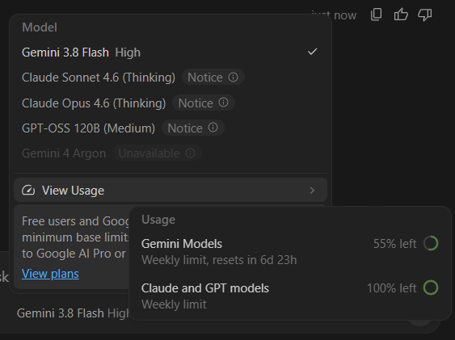
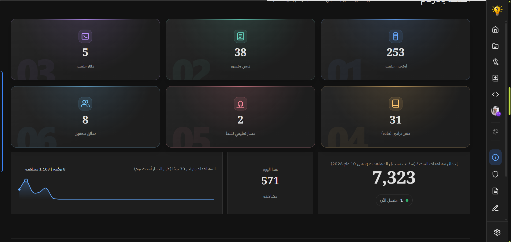

## Issue 4: Lesson Upload check issue
When I try to upload a lesson, manuy times I get this `حقل غير مسموح بيه في العنصر رقم 1: "id"` error for no reason, update the checks: 

## Issue 8: Quiz OG Thumbnail Issue 

OG Thumbnails for Quizzes don't cut long descriptions, it should've had this at the end: `...`, instead of making the whole description unreadable.