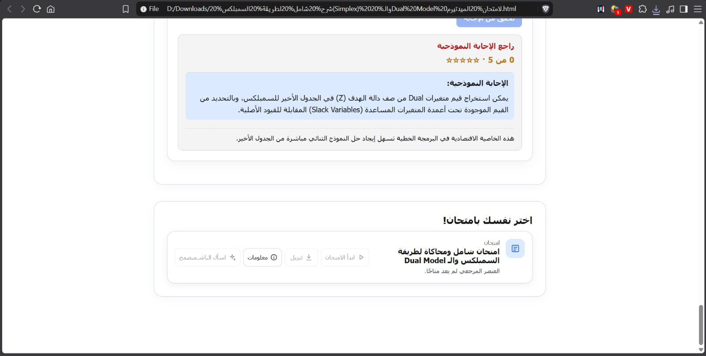
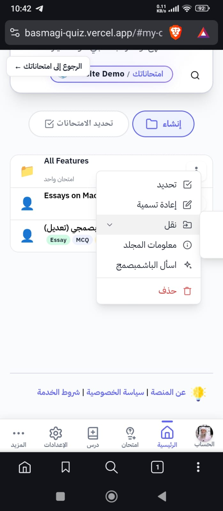
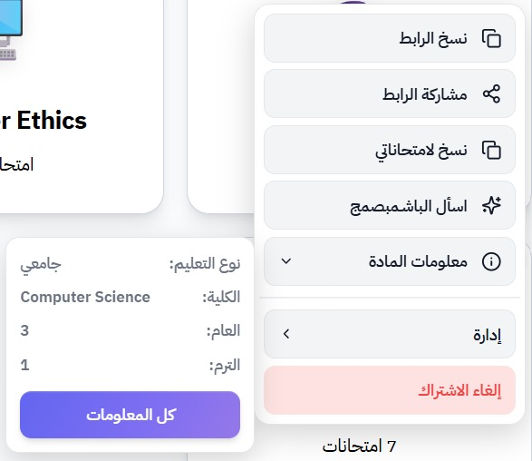
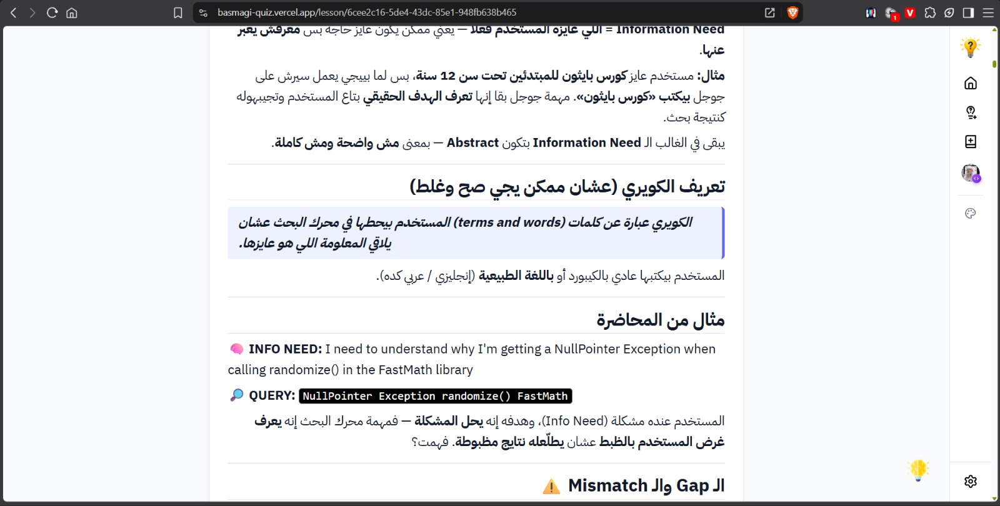
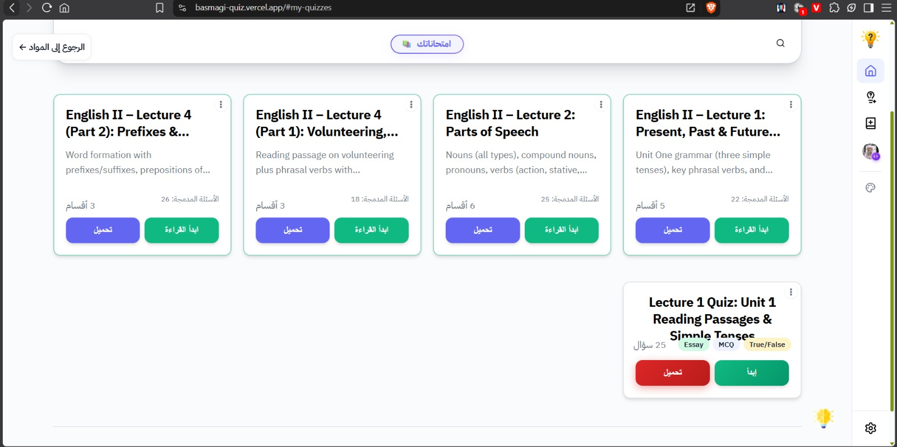
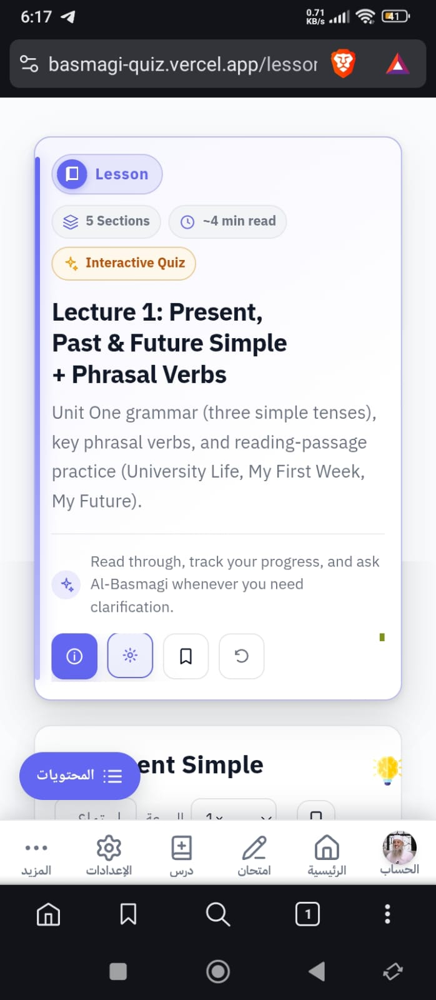

## Issue 1: Downloaded lessons (HTML)


Embedded elements in downloaded lessons don't have working links (The "ابدأ الامتحان" is disabled). It should work, since it's just a link.

## Issue 2: Lesson Page Improvement
Lessons should be downloadable from the lesson page itself.

## Issue 3: Home Page (امتحاناتك section) UI Issue
The `#userQuizContextMenu` menu is opening its submenu out of the screen on phones: 


## Issue 4: Lesson Upload check issue
When I try to upload a lesson, manuy times I get this `حقل غير مسموح بيه في العنصر رقم 1: "id"` error for no reason, update the checks: 

## Issue 5: View coutner on Lessons & Quizzes
* Lessons should have a view counter just like quizzes. 
* The quiz view counter is something special, so it should be designed specially in the quiz info modal. And it should be viewed from the quiz page, and result page, and embedded quizzes in the lesson page. Meaning it should appear on the quiz's info modal everywhere except for downloaded quizzes.

## Issue 6: Update the info submenu `.submenu-content` of `.exam-dropdown-menu`
 

Update the submenu for quizzes, lessons, folders, & courses to contain these:

# Courses & Folders
* Number of Quizzes (امتحان)
* Number of Lessons (درس)
* Number of Folders (مجلد)
* The Course Creator (إعداد)
# Quizzes & Lessons
* I Want to add the number of views, but it already has many elements at the small info submenu, so recommend the most valuable info to me.

## Issue 7: Update the `.exam-dropdown-menu` (Just a suggestion)
Is adding embedding link to quizzes and lessons' `.exam-dropdown-menu`? For things like embedding them in Notion notes or other websites? Tell me before implementing it.

## Issue 8: Quiz OG Thumbnail Issue 

OG Thumbnails for Quizzes don't cut long descriptions, it should've had this at the end: `...`, instead of making the whole description unreadable.

## Issue 9: Text-Selection issue
Selecting text is reverted. This issue maybe related to the text-hightlighting engine, or I might be wrong.

Description of the issue: 
* When I use the right & left arrows on keyboard to navigate text on the create-quiz page: 
    * Pressing right arrow --> goes right (Correct behavior)
    * Pressing left arrow --> goes left (Correct behavior)
* When I use them to *Select Text*:
    * Pressing shift + right arrow --> selects text on the left (incorrect behavior)
    * Pressing shift + left arrow --> selects text on the right (incorrect behavior)

I tested and found the issue on: 
* Create-Quiz Page
* Create-Lesson Page

I tested it on LTR text (e.g., English not Arabic)

## Issue 10: Quiz Page UX Improvement
True/False options should have icon feedback (correct green icon or incorrect red icon). That next to coloring the options, would make great UX, because coloring the options themselves isn't enough, because some people are color blind, other people use grayscale mode on their screens.

## Issue 11: Markdown Engine Alignment issue (needs verification)
Quetes are always aligned to the left no matter the text it holds is Arabic or English.



## Issue 12: امتحاناتك Trash Verification message
This confirmation message:
```
سيتم حذف كل العناصر الموجودة في سلة المهملات نهائياً ولا يمكن التراجع عن هذا الإجراء.
للمتابعة، اضغط "نعم" ثم اكتب العبارة المطلوبة في الخطوة التالية.

```

Which appears when users try to clear their trash (امتحاناتك), it actually appears under the trash model. Fix the z--index.

*AI Claims it got solved, but it didn't*

## Issue 13: Home UI Issues


Many UI Issues with Quiz and Lesson cards both inside of امتحاناتك and the main platform + incosistensies between them.

UI Issues: 
1. The 2 subtexts on the lesson cards (e.g., "الأقسام: 6 الأسئلة المدمجة: 25") are misaligned together. (FIXED)
2. The title of quizzes isn't being cut for longer titles like lessons. (NOT FIXED)

## Incosistencies
1. The Quiz card design inside امتحناتك has better design that the one on the main platform, specially for the pills of the types of questions (e.g., MCQ, True/False, Essay). (FIXED)
2. Same with the lesson card, the design of the main platform doesn't actually have the (الأسئلة المدمجة) label at all. (NOT FIXED: THE `الأسئلة المدمجة` STILL DOESN'T APPEAR ON THE MAIN PLATFORM'S LESSONS)

Both must be consistent.

## Issue 14: Lecture Page UI Issue on Phones


The second button's modal doens't appear for some reason, but a very tiny scrollbar on the right appears.